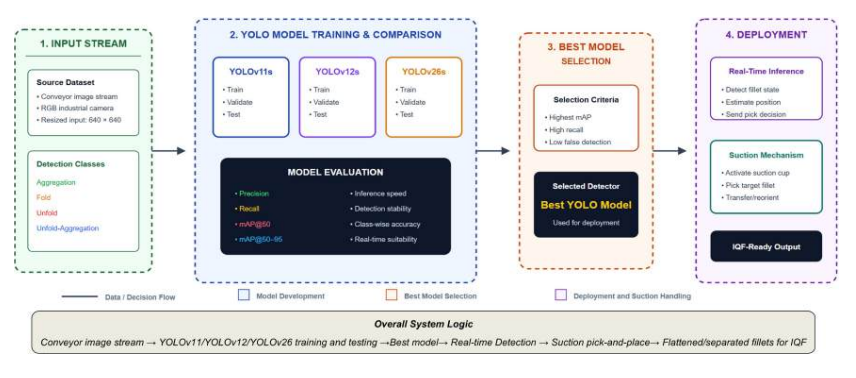
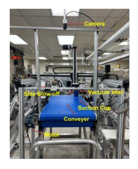
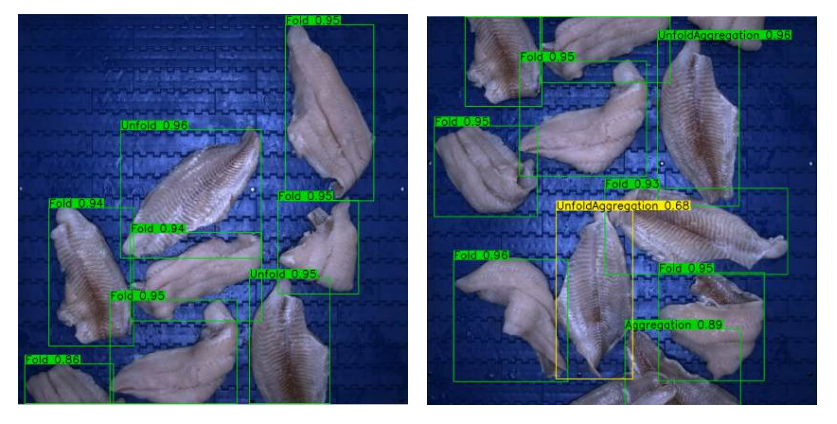
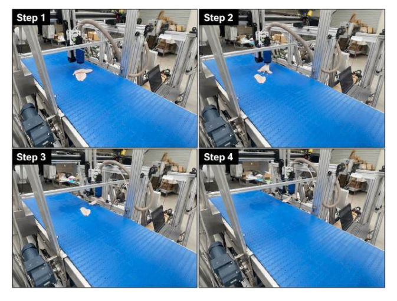

# AquaPick
### Vision-Guided Robotic Handling of Deformable Catfish Fillets

**Machine vision · Tracking · Camera-to-robot mapping · Suction manipulation**

[Related SPIE paper](https://doi.org/10.1117/12.3095045) · [Related ASABE paper](https://doi.org/10.13031/aim.202500466) · [Results](#reported-spie-experiments) · [Code availability](#code-availability)

*Figure 1 from the related SPIE paper: detector development and selection feed a real-time handling workflow.*

## Overview

AquaPick connects real-time RGB perception with robotic handling of deformable fillets for **individual quick freezing (IQF) preparation**. The research combines fillet-state recognition, multi-object tracking, conveyor-motion prediction, geometric camera-to-robot mapping, and suction-based manipulation.

My contributions include dataset curation, detector evaluation, tracking, coordinate mapping, system integration, and physical validation at Michigan State University as part of a USDA-NIFA-AFRI research project.

**Research status:** ongoing project with related SPIE/ASABE work and an AquaPick journal manuscript under review. The journal manuscript is not presented as accepted. The figures and detailed quantitative tables below document the **related SPIE gantry study**, not the later delta-arm or journal experiments.

## Perception-to-action pipeline

1. Acquire RGB conveyor images and classify fillet states.
2. Detect **Aggregation, Fold, Unfold, and Unfold-Aggregation**.
3. Maintain object identity and estimate motion using Kalman-filter-based tracking.
4. Map image locations into robot coordinates using the calibrated region of interest and fixed offsets.
5. Predict an interception location and execute a suction-handling action.
6. Review physical outcomes, including vacuum sealing, missed targets, and post-pick geometry changes.

*Figure 2: the related SPIE experimental setup uses a three-axis gantry and suction end-effector. Later delta-arm work is a separate development.*

## Dataset and detector protocol

| Item | Reported setting |
| --- | --- |
| Dataset | 3,400 images; 21,424 annotated instances |
| Classes | Four operational fillet states |
| Image split | 2,800 train / 400 validation / 200 test |
| Test annotations | 1,147 instances |
| Models | YOLOv11s, YOLOv12s, YOLOv26s |
| Input size | 640 × 640 |
| Training | AdamW; initial LR 0.001; cosine decay; 100 epochs; batch size 16 |
| Conveyor speed | 14 cm/s in the reported setup |

## Reported SPIE experiments

These values come from the supplied SPIE paper and have not been independently rerun for this repository. Detection benchmarks and physical handling trials measure different parts of the system.

### Detector comparison

| Model | Precision (%) | Recall (%) | mAP@0.5 (%) | mAP@0.5:0.95 (%) |
| --- | ---: | ---: | ---: | ---: |
| **YOLOv26s** | **87.1** | **86.0** | **90.6** | **85.6** |
| YOLOv11s | 86.0 | 85.4 | 89.8 | 84.9 |
| YOLOv12s | 84.5 | 83.6 | 87.6 | 82.8 |

*Figure 9: representative detections from the related SPIE study.*

### Physical handling

| Trial outcome | Reported result |
| --- | ---: |
| Final fold-handling success | 44 / 50 = 88.0% |
| Mean fold processing time | 12.02 ± 0.57 s over 49 timed trials |
| Final aggregation-handling success | 39 / 49 definite outcomes = 79.6% |
| First aggregation-attempt success | 43 / 50 = 86.0% |

The 50 logged aggregation trials include one without a definite final Y/N label; the final-success denominator is therefore 49. First-attempt success and final trial success use different definitions and must not be combined.

*Figure 13: a successful aggregation-handling sequence in the gantry study.*

## Current research direction

The broader AquaPick effort extends toward delta-arm picking, transfer, and reorientation. The updated CV describes physical evaluation on **280 fillets** for the broader project. That count belongs to the later project scope and is not the denominator for the preliminary SPIE fold/aggregation results above. No later throughput figure is substituted into those experiments.

## Limitations

The reported gantry trials are preliminary laboratory experiments. Wet surfaces, deformability, occlusion, lighting changes, vacuum sealing, and evolving pile geometry affect reliability. Bounding-box centers are not always suitable suction contact points. ROI-based mapping is sensitive to camera and belt movement, and plant-scale performance is not established by the laboratory trials.

## Code availability

**Code will be available upon acceptance of the AquaPick journal paper.** This repository currently contains the project description, figures, and experiment summaries; control software, model weights, datasets, and hardware integration code are not released here.

## Related work and attribution

- Mehedi Hasan, Yi Jing, Yuzhen Lu, and Wenbo Liu. *Real-time vision-guided catfish fillet recognition and suction handling for automated individual quick freezing preparation*. Related SPIE work, 2026. [DOI](https://doi.org/10.1117/12.3095045). Author order here follows the supplied paper.
- *A Machine Vision System for Online Detection of Catfish Fillets Towards Automated Preparation for Individual Quick Freezing*. ASABE, 2025. [DOI](https://doi.org/10.13031/aim.202500466).
- *AquaPick: Intelligent Vision-Guided Robotic Handling of Deformable Fish Fillets for Automated IQF Processing*. Journal manuscript under review, 2026.

Figures are credited to the authors of the related SPIE paper; see [figure provenance](assets/README.md). The SPIE publisher proof itself is not redistributed in this repository.

[Research profile](https://github.com/mhasan96) · [Website](https://sites.google.com/view/i-am-mehedi) · [Contact](mailto:hasanme1@msu.edu)
